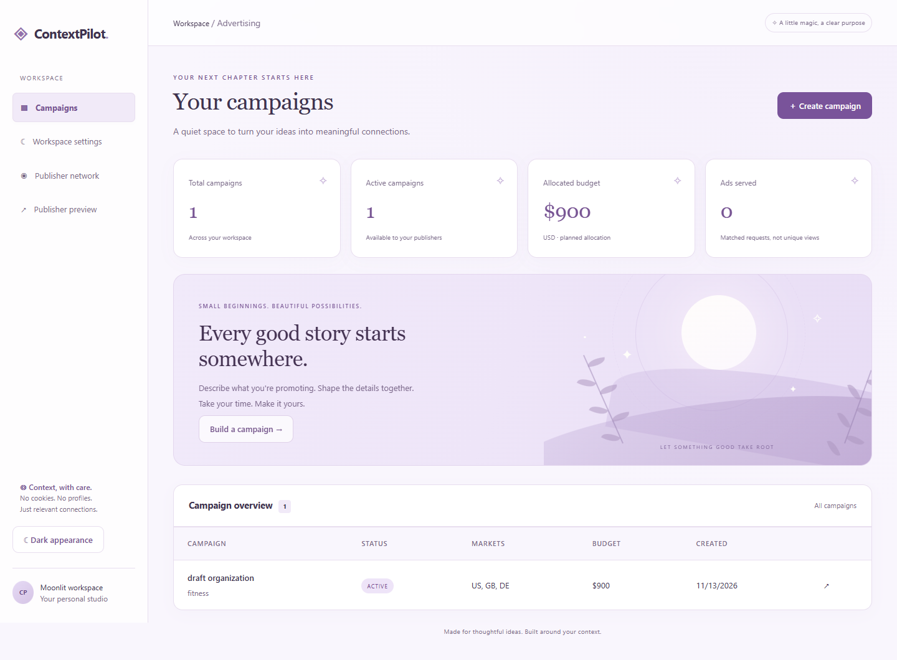
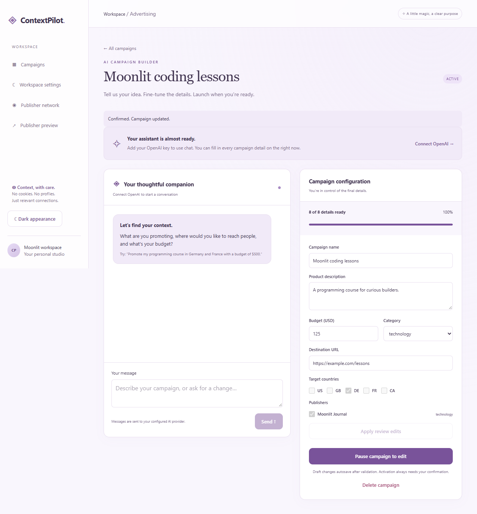
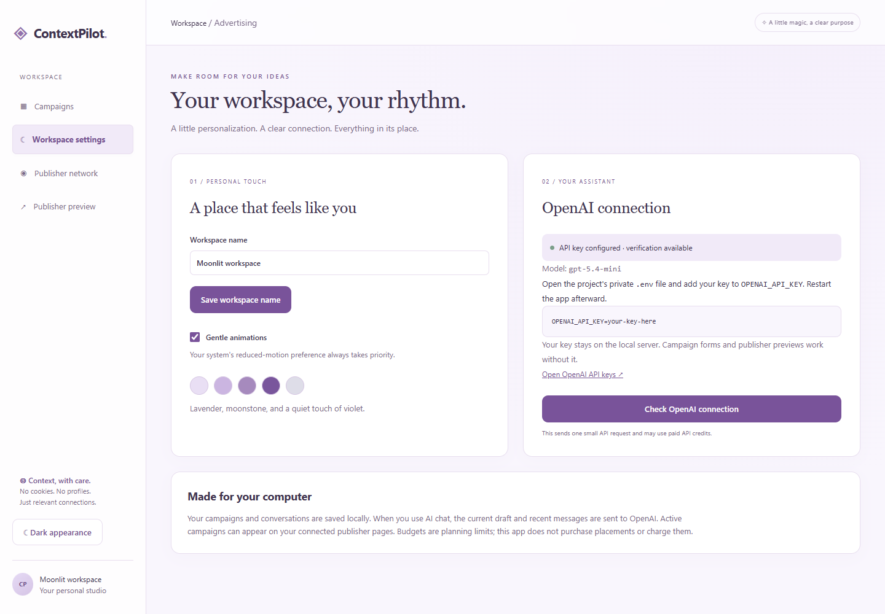

# ContextPilot 

Your personal campaign studio: a soft lavender interface, a real OpenAI assistant, persistent campaigns, and contextual placements on your own publisher pages.

## Start your workspace

Dependencies and the local database are already installed on this computer:

```powershell
cd "C:\Users\HP\Documents\New project\contextpilot"
npm run dev
```

Open the dashboard at http://localhost:5173 and the publisher preview at http://localhost:5174. Stop with Ctrl+C. If an older instance is running, stop it before starting the updated app.

For a fresh installation: `npm ci`, copy `.env.example` to `.env`, run `npm run db:setup`, then `npm run build` and `npm run dev`.

## Connect OpenAI

1. Sign in at [OpenAI API keys](https://platform.openai.com/api-keys) and create a secret key for this project.
2. Paste it only into the root `.env` file after `OPENAI_API_KEY=`. Do not put it in frontend code, chat, screenshots, or Git.
3. Restart `npm run dev`.
4. Open **Workspace settings → Check OpenAI connection**. This makes one small API call and validates a structured response. API usage may require billing/credits.

```dotenv
AI_MODE=live
AI_PROVIDER=openai
AI_BASE_URL=https://api.openai.com/v1
AI_MODEL=gpt-5.4-mini
OPENAI_API_KEY=
AI_TIMEOUT_MS=30000
```

You can also run `npm run ai:check`. It reports a safe result, never the key. The app uses the OpenAI Responses API, strict function output, and server-side Zod validation. The model proposes changes; your confirmation activates them. No-key mode keeps manual editing available and clearly disables AI chat; it does not pretend a rule-based parser is OpenAI.

Official references: [Responses function calling](https://developers.openai.com/api/docs/guides/function-calling), [model](https://developers.openai.com/api/docs/models/gpt-5.4-mini), [API quickstart](https://developers.openai.com/api/docs/quickstart).

## What works

- Create, edit, save, activate, pause and delete campaigns, with SQLite persistence and revision checks.
- Chat with OpenAI once a key is configured; validate every proposal before applying it.
- Configure your workspace name and gentle animations. Reduced-motion preferences are respected.
- Add and remove your own publishers, with copyable TypeScript integration code. Publishers used by campaigns cannot be deleted until unlinked.
- Preview active ads by publisher and country. Matching uses category, keywords, targeting, campaign status and budget eligibility.
- See actual aggregate **Ads served** counts. These count matched API responses, including preview refreshes—not unique people or verified views.
- Switch between lavender daylight and violet night themes on desktop or mobile.

**Budget is a planning limit.** The app does not buy third-party ad inventory, process payments, or charge budgets. It runs on your computer, not a publicly hosted advertising network. Adding a publisher record does not automatically install its SDK.

## Your data

Your campaigns and conversations are stored in `apps/api/prisma/dev.db`. Only the original unchanged seeded campaign was removed during personalization; your other campaigns were preserved. A JSON snapshot from before cleanup is in the ignored `backups/` folder. The included Moonlit Journal is a local preview page, not an outside publisher partnership.

The original `impressions` field remains in storage for backward compatibility but is not shown as real activity. `servedRequests` starts at zero and increments only when an eligible ad is returned. Requests do not identify or profile visitors.

Campaign drafts and recent messages are sent to OpenAI when you use chat. Requests use `store:false`; this is not a claim that provider retention policies are disabled. Keys stay on the server. This is a local single-owner application: do not expose the unauthenticated API publicly.

## Environment

| Variable               | Purpose                                                                              |
| ---------------------- | ------------------------------------------------------------------------------------ |
| DATABASE_URL           | SQLite file, defaults to `file:./dev.db` relative to Prisma schema                   |
| OPENAI_API_KEY         | Private OpenAI credential                                                            |
| AI_MODE                | `live` for personal use; `demo` is retained solely for deterministic automated tests |
| AI_PROVIDER            | `openai`; legacy compatible adapter available with another value                     |
| AI_MODEL / AI_BASE_URL | Explicit provider model and endpoint                                                 |
| AI_TIMEOUT_MS          | Per-attempt provider timeout; bounded SDK retries may extend total duration          |
| PORT                   | API port, defaults to 4000                                                           |
| CORS_ORIGINS           | Exact allowed browser origins, including localhost and 127.0.0.1 on ports 5173/5174  |

Other local publisher sites need their exact origin added to CORS_ORIGINS. Restart after changing `.env`.

## Checks

```sh
npm run build
npm run typecheck
npm run lint
npm test
npx playwright install chromium
npm run test:e2e
```

Unit/API tests use `test.db`. Browser tests use `e2e.db` and separate ports 4100/5273/5274, with a deterministic injected provider and no API keys. They do not edit your personal database or interrupt your app. Live OpenAI verification is separate and requires your key.


## Screenshots





## Scope

Personal local use, five supported country codes (US, GB, DE, FR, CA), USD planning budgets, and deterministic contextual scoring. There are no user accounts, payment processing, production ad auction, automated deployment, or verified human-impression analytics. Manual workflows run without a key; a live OpenAI round trip cannot be verified until a valid key and model access are available.
