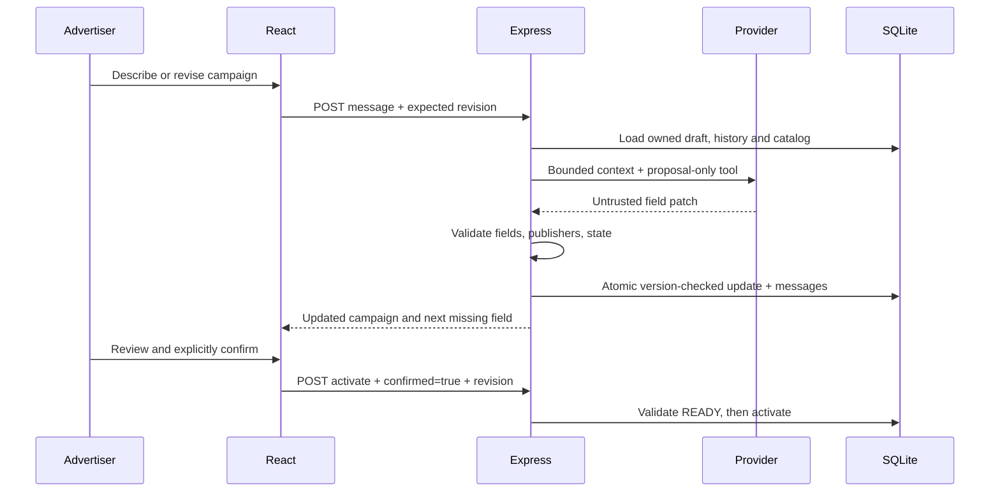
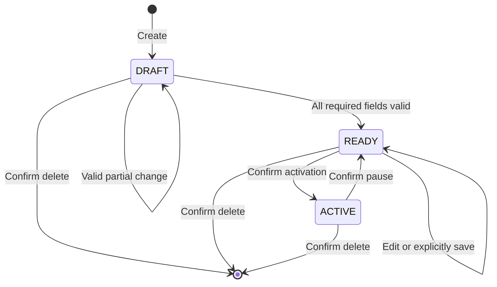

# Architecture

The system uses one trusted API and three clients: the advertiser dashboard, the publisher demo, and the reusable SDK. Business rules live in the API; TypeScript shared types improve developer feedback, while Zod enforces runtime boundaries.

## Source map

`app.ts` is a compact REST composition layer: middleware, request schemas and thin handlers. Domain services own campaign operations; `repositories.ts` owns common database access and row serialization. Transactional writes stay in services so their atomic boundaries remain visible. This avoids a generic repository framework that would obscure a small application.

`ai/provider.ts` translates a provider response into a patch. `services/conversation.ts` orchestrates history, proposals, validation and follow-up prompts. `services/campaigns.ts` controls states and optimistic concurrency. `services/matching.ts` handles ad eligibility and ranking.

## Schema

| Model     | Important columns                                                      | Purpose                                     |
| --------- | ---------------------------------------------------------------------- | ------------------------------------------- |
| Publisher | id, name, category                                                     | Server-owned fictional catalog              |
| Campaign  | id, ownerId, data, status, version, createdAt, impressions, spentCents | Validated JSON draft and lifecycle metadata |
| Message   | id, campaignId, role, content                                          | Ordered conversation with cascade deletion  |

Draft fields are JSON text because incomplete drafts are central to the product and SQLite setup should stay small. Application validation is therefore essential; the database cannot enforce every JSON constraint. Status is also validated by services rather than a SQLite enum. A larger service should normalize targeting and creatives and use database constraints/migrations.

## Lifecycle

Active campaigns cannot be edited. Every write requires an expected integer version. An update uses `WHERE id, ownerId, version, status`; an affected-row count of zero returns HTTP 409. Conversation messages and field changes commit in one transaction, so a failed proposal does not leave a misleading chat history. A concurrent AI call can be wasted, but cannot overwrite a newer revision.

## API reference

All paths below start with `/api`. Mutation requests except public matching require `X-ContextPilot-Demo: 1`. This is a local browser-write guard, **not a credential**.

| Method and path                | Request / response                                       |
| ------------------------------ | -------------------------------------------------------- |
| GET /health                    | Mode and single-user marker                              |
| GET /publishers                | Publisher array                                          |
| GET /campaigns                 | Serialized campaign array                                |
| POST /campaigns                | `{confirmed:true}` → empty persisted draft, 201          |
| GET /campaigns/:id             | `{campaign,messages}`                                    |
| PATCH /campaigns/:id           | `{version,patch}` → validated campaign                   |
| POST /campaigns/:id/messages   | `{version,content}` → campaign, history, missing, tokens |
| POST /campaigns/:id/transition | `{version,action:'save'                                  | 'activate' | 'pause',confirmed:true}` |
| DELETE /campaigns/:id          | `{version,confirmed:true}` → 204                         |
| POST /ads/match                | `{publisherId,country,category,keywords}` → `{ad:null    | Ad}`       |

Errors use `{error:{code,message}}`: 400 malformed JSON, 403 origin/header guard, 404 missing resource, 409 stale or illegal state, 422 invalid data, 429 AI rate limit, 502 provider errors, 503 unconfigured live AI, 504 timeout. Internal exceptions never return stack traces, keys or raw provider messages.

## Matching

First filter to active, valid campaigns targeting the supplied publisher and country, with `spentCents < round(budget*100)`. Score +2 for publisher category equality, +2 for supplied page category equality, and +1 per keyword found in the campaign category's fixed vocabulary. Require score ≥2. Sort by score descending; initial ID order provides deterministic ties. Return one ad, or null.

This does not understand semantics, enforce publisher honesty, optimize conversions or implement bidding. Publishers explicitly provide context and country. No visitor profile, cookie, fingerprint, impression write or spend mutation is involved. Catalog category relevance can qualify an ad even when specific keywords differ.

## Security boundary

The server fixes the owner to `local-demo` and never accepts an owner ID from a client. All catalog references and campaign fields are checked server-side. Model tools cannot invoke lifecycle endpoints. The web uses React text escaping; the SDK uses `textContent` and validated HTTP(S) links. CORS uses an explicit allowlist, JSON bodies are bounded, and AI traffic has a per-IP rate limit. Production requires real identity and resource authorization, not merely additional headers.
